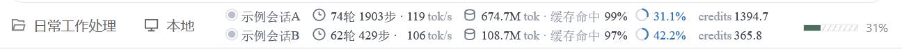

# QoderMonitor —— Qoder CN 会话监控

最初是在用 DeepSeek Harness（DSH）时，觉得它显示的输出速度、缓存命中等数据很有意思，能一眼看清模型这段时间的具体使用情况。Qoder CN 的界面上恰好有一块空白位置，于是照着这个思路做了这个小工具：把同样的会话指标放进一条不遮挡内容的透明窄条里。

从 2.0 起，发布版是一个独立的 `QoderMonitor.exe`：双击即用，不需要 Python，也不再有独立的采集进程和 `bar_state.json`。


上图为示例数据；窄条背景本身完全透明，图中浅色底只是截图时临时铺的衬底。



第二张为 Qoder CN 状态栏中的实际显示效果，两行为示例会话数据。

## 快速开始

**系统要求**：Windows 10/11 x64、已安装 Qoder CN。不需要 Python，不需要管理员权限。

1. 从 [Releases](https://github.com/StephenBoyMi/QoderMonitor/releases/latest) 下载 `QoderMonitor-v*.zip` 附件（不是 GitHub 自动生成的 Source code）。
2. 解压后双击 `QoderMonitor.exe`，窄条立即出现，托盘同时常驻。
3. 再次双击同一 exe 会唤醒已有窗口，不会启动第二条；托盘菜单可显示/隐藏、切换前台跟随、开机自启和退出。

`QoderMonitor.exe` 未做代码签名，Windows SmartScreen 可能提示“未知发布者”，选择“更多信息 → 仍要运行”即可。

## 组成

| 文件 | 说明 |
| --- | --- |
| `QoderMonitor.exe` | 单文件发布版，数据采集 + DirectComposition 渲染 + 托盘 |
| `single/App.cs` | 窗口、布局、绘制、拖动、菜单、前台跟随、托盘和单实例 |
| `single/Data.cs` | transcript 增量解析、`SessionStats`、`decode_tps`、`metrics`、标题读取 |
| `single/Interop.cs` | Win32 / D3D / DXGI / DComp / D2D / DWrite 的 P/Invoke 与 vtable |
| `single/build-app.ps1` | 构建单 exe（系统自带 .NET Framework csc） |
| `single/build.ps1` | 构建数据层验证程序 `qoder_data.exe` |
| `single/parity_test.py` | Python/C# 数据层 parity 测试 |
| `docs\` | README 示例截图 |
| `LICENSE` | MIT 许可证 |
| `qoder_monitor.py`、`bar_dcomp.exe`、`monitor-toggle.ps1` 等 | 1.0.x 的 Python 版与旧开关，仓库保留作回退，不进入 2.x 发布包 |

## 数据流

```
~/.qoder-cn/projects/*/*.jsonl
        │  C# SessionStats 增量解析
        ▼
   SessionCache ──进程内──▶ metrics / decode_tps
        │
        ▼
   DirectComposition 透明窄条
```

- 不再启动 `pythonw`，不再写 `bar_state.json`、`bar_pid.json`。
- 单实例由 `Global\QoderMonitorBar` 互斥体保证；第二次启动只唤醒已有窗口。
- 数据层与 Python 版做过逐项对比：63 个静态 transcript 的快照、标题、statusline、JSON 全部一致。

## 使用

**启动**：双击 `QoderMonitor.exe`。若 Qoder 不在前台，会先强制显示 8 秒，之后按“前台跟随”设置决定是否隐去。

**托盘菜单**：

- 显示悬浮条
- 总在最前
- 只在 Qoder 前台时显示
- 开机自启（写入当前用户的 Run 项，不需要管理员）
- 退出

**窄条操作**：左键按在字或图标上拖动，位置写入 `pos.json`；右键菜单可退出、切换置顶、切换前台跟随；双击退出。

**停止 / 卸载**：托盘菜单退出，或双击窄条；删除 exe 与 `%LOCALAPPDATA%\QoderMonitor\` 即可，不写注册表（除非手动开启了开机自启）。

**配置与日志**：`%LOCALAPPDATA%\QoderMonitor\pos.json` 存位置和 `pin` / `follow`，`logs\QoderMonitor.log` 存启动 DPI、surface 尺寸和 SHOW/HIDE。exe 可以单独放在桌面，不会在桌面生成配置文件。

## 界面与操作

- 一条无底板的透明窄条，最多两个会话行。
- 每行：状态点、标题、轮数/步数、tok/s、总 tokens 与缓存命中、上下文环、credits。
- 标题最多 6 个字符，超出显示前 5 字加 `…`，两行共用列宽。
- 状态点绿色表示会话忙或文件 25 秒内有写入，灰色为空闲。
- 取最近 30 分钟内有写入的会话，按最后修改时间由新到旧最多显示两行；每行的数字是该会话自己的整场累计。
- 零会话时只保留托盘图标，不显示空窄条。

## 指标口径

| 指标 | 来源与说明 |
| --- | --- |
| 模型用时 | 请求发出到响应落盘的时间戳配对；与 `qodercli.log` 交叉核对差 0.9% |
| 工具用时 | 模型回复结束到最后一个 `tool_result` 写回；并行工具合并为一段 |
| 轮数 / 步数 | 轮 = 不同 `promptId`，会低估；步 = 已闭合的 assistant 响应组数，以步数为准 |
| tok/s | 优先用逐请求「时长—输出 token」回归得到的边际解码速率，尽量剥离排队与首字等待；样本不足或拟合差时退回端到端平均并标 `(e2e)`，拟合样本含字符估算时标 `(估)`。它是估计值，不保证与 dsh 逐位一致 |
| 上下文 % | 优先 Qoder 回传的 `context_usage_ratio`；窗口大小取 Qoder 回传值（本机为 1,000,000） |
| 缓存命中 | `cache_read ÷ input_tokens`；Qoder 的 `input_tokens` 已包含 cache_read，代码另有 `cache_read > input` 的护栏 |
| credits | 优先 Qoder 回传的 `total_credits`；回退到 transcript 时按 `request_id` 去重累加。各行独立，不做跨会话合计 |
| TTFT | 客户端不记录，界面不提供 |

系统模型默认把 token 抹零，只有 BYOK 或设置环境变量 `QODERCN_EXPOSE_TOKEN_USAGE=1` 并重启 Qoder CN 后才保留真值；没有真值时按字符估算（中日韩 1.4 字/token，其余 4 字符/token），误差约 10~20%。

## statusLine（可选）

`~/.qoder-cn/settings.json` 顶层加：

```json
"statusLine": {
  "type": "command",
  "command": "<QoderMonitor.exe 的绝对路径> --statusline"
}
```

把占位符换成实际路径；该文件还可能同时存有 hooks 和 providers（其中可能含明文 apiKey），修改时必须“备份 → 只加这一个键 → 逐键比对”，不要整份覆盖。`--statusline` 只读 stdin、不启动窗口，输出与界面同一份 `metrics()` 结果。设置项 `requiresRestart: false`，但正在运行的会话不会重读设置，新开一个会话才会出现这一行。

## 重新编译

```powershell
cd single
powershell -File build-app.ps1
```

输出 `single\QoderMonitor.exe`。数据层验证程序用 `build.ps1`；Python/C# 对照用 `python parity_test.py`。

`csc.exe` 用系统自带的 .NET Framework 版本即可，通常在 `C:\Windows\Microsoft.NET\Framework64\v4.0.30319\csc.exe`，不必安装 Visual Studio。

## 运行时文件

| 文件 | 内容 |
| --- | --- |
| `%LOCALAPPDATA%\QoderMonitor\pos.json` | `dcomp_x` / `dcomp_y`（DIP）、`pin`、`follow` |
| `%LOCALAPPDATA%\QoderMonitor\logs\QoderMonitor.log` | 启动 DPI、surface 尺寸、SHOW/HIDE、异常 |

## 验证

- 看窄条是否出现两行数据；切换 Qoder 前后是否按 `follow` 显示/隐藏。
- 第二次双击 exe，任务管理器里应仍然只有一个 `QoderMonitor.exe`。
- 日志 `%LOCALAPPDATA%\QoderMonitor\logs\QoderMonitor.log` 应出现 `dpi=...`、`surface ...x...`、`SHOW ...`。
- 数据层逐项验证见 [single/README.md](single/README.md)。

## 许可证

本项目以 MIT 许可证发布，详见 [LICENSE](LICENSE)。

## 鸣谢

[TrafficMonitor](https://github.com/zhongyang219/TrafficMonitor) 的作者 [zhongyang219](https://github.com/zhongyang219)：这个项目的轻量悬浮显示与 Windows 窗口处理思路给了本项目重要参考，特此致谢。本项目未直接复用其代码。
